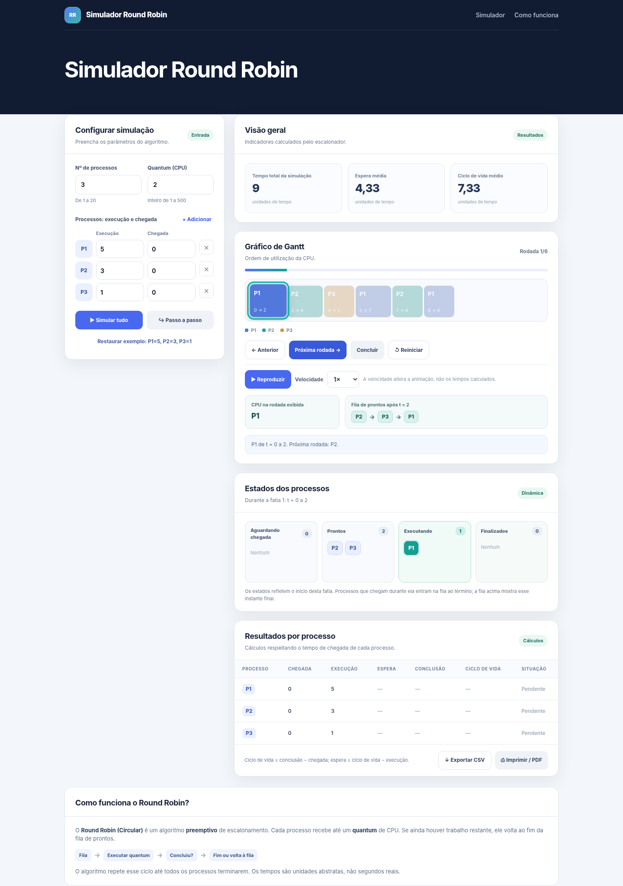

# Simulador Round Robin

Simulador didático do algoritmo de escalonamento de processos **Round Robin (Circular)**, desenvolvido para a disciplina de **Sistemas Operacionais**.

🔗 **Acesse a versão publicada:** https://simulador-round-robin2.netlify.app/

## Objetivo

Demonstrar como o escalonamento Round Robin distribui a CPU entre processos, respeitando o **quantum** e os **tempos de chegada**, e calcular os tempos de conclusão, espera e ciclo de vida.

## Funcionalidades

- Configuração da quantidade de processos, chegada e duração de cada um.
- Configuração do quantum.
- Fila de prontos e visualização dos estados dos processos.
- Execução passo a passo e reprodução automática com controle de velocidade.
- Gráfico de Gantt e tabela de resultados.
- Validação das entradas e exportação dos resultados em CSV.
- Funcionamento offline, sem bibliotecas externas.

## Como executar

1. Baixe o arquivo `index.html` deste repositório.
2. Abra o arquivo em um navegador moderno.
3. Configure os processos e o quantum e inicie a simulação.

Não é necessário instalar Python, Node.js ou qualquer pacote.

## Exemplo de validação

Todos os processos chegam no tempo **0**, e o quantum é **2**.

| Processo | Tempo de execução | Tempo de espera | Conclusão | Ciclo de vida |
| --- | ---: | ---: | ---: | ---: |
| P1 | 5 | 4 | 9 | 9 |
| P2 | 3 | 5 | 8 | 8 |
| P3 | 1 | 4 | 5 | 5 |

A CPU executa na ordem `P1 → P2 → P3 → P1 → P2 → P1`.

As relações consideradas são:

- **Ciclo de vida** = tempo de conclusão − tempo de chegada.
- **Tempo de espera** = ciclo de vida − tempo de execução.

## Tecnologias

- **HTML** para a estrutura;
- **CSS** para o layout e a responsividade;
- **JavaScript** para a simulação, cálculos e interações.

Toda a aplicação está no arquivo `index.html`. O simulador **representa** o escalonamento; ele não gerencia processos reais do sistema operacional.

## Projeto acadêmico

**Disciplina:** Sistemas Operacionais  
**Instituição:** UNDB  
**Professor:** Daniel Carneiro  
**Período:** 2026.2

**Entregas:** modelagem do algoritmo e protótipo com testes de funcionalidade.
